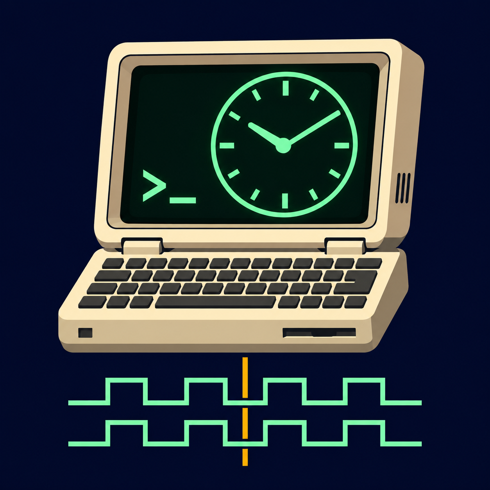
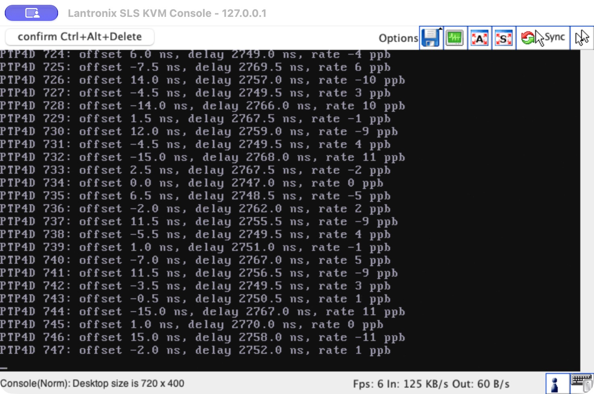
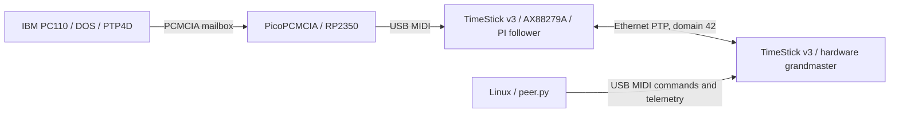
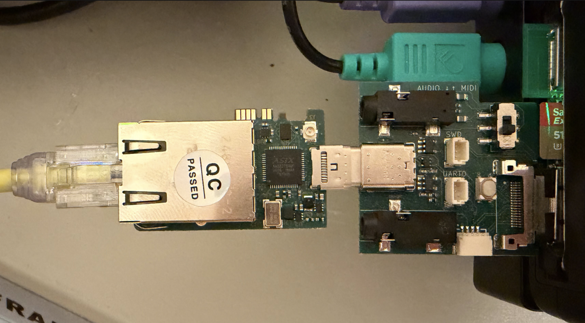
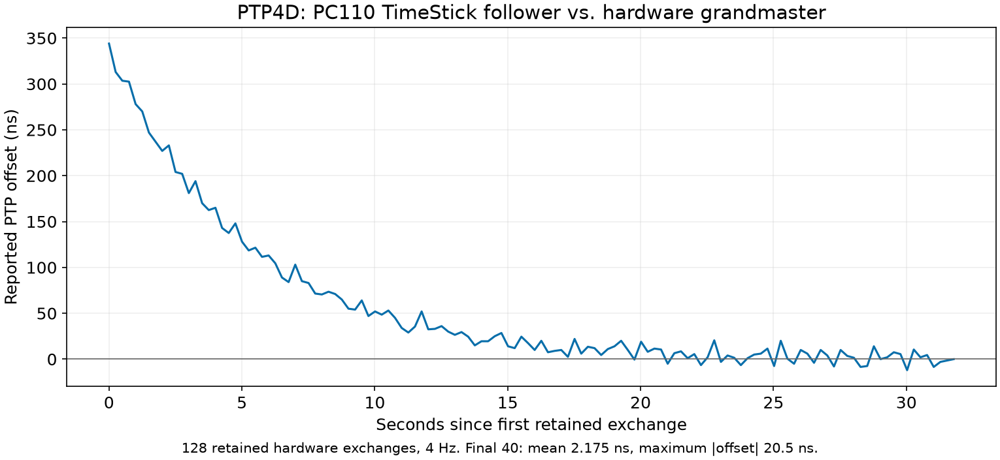

# PTP4D: PTP for DOS

**PTP4D stands for PTP for DOS.** It brings hardware-clock PTP control to real-mode DOS through PicoPCMCIA and a TimeStick v3.

**[Download PTP4D.EXE](https://github.com/ahmadexp/PTP4D/releases/latest/download/PTP4D.EXE)** | [Release notes](https://github.com/ahmadexp/PTP4D/releases/latest) | [SHA-256 checksum](https://github.com/ahmadexp/PTP4D/releases/latest/download/SHA256SUMS)

The first working setup is an IBM PC110 running MS-DOS 6.22. PTP4D configures and monitors the TimeStick's on-device PI servo, while the TimeStick exchanges hardware-timestamped PTP messages over Ethernet. The DOS system clock is unchanged.


*A one-minute AUTO_PI trial from the development build, photographed on the physical PC110. The display shows reported offset, path delay, and frequency correction. [Full-size photo](docs/photos/pc110-auto-pi-servo.jpg).*

## What works

- TimeStick identification and hardware-clock reads over USB MIDI.
- PTP follower operation in domain **42**, at **4 exchanges per second**.
- Live offset, mean path delay, and acknowledged frequency-correction display.
- Timed runs or continuous operation until **Esc**.
- Renewable 15-second device leases and verified STOP acknowledgements.
- CSV output containing the last 128 complete hardware timestamp exchanges.
- A Linux TimeStick grandmaster controller and an optional SSH/COMrade pair controller.

The DOS program configures a **PI (proportional-integral) servo inside the TimeStick firmware**. It does not implement a separate DOS-side servo or timestamp packets using the PC110 CPU.



*Actual PC110 display during continuous synchronization. The screenshot is an unedited capture of the Lantronix console, not an emulated or reconstructed terminal.*

## Hardware path



Tested configuration:

| Component | Tested version or behavior |
| --- | --- |
| Computer | IBM PC110, MS-DOS 6.22 |
| PCMCIA card | PicoPCMCIA hardware v4.4, stock firmware v0.22, protocol 2 |
| DOS resident driver | Matching v0.22 `PICOCARD.EXE` |
| Timing devices | Two TimeStick v3 devices with USB MIDI timing firmware |
| USB connection | TimeStick connected directly to the PicoPCMCIA USB-C breakout |
| Ethernet | Direct cable between the two TimeSticks |
| Grandmaster host | Linux with an accessible ALSA raw MIDI device |

A readable microSD card must be installed in PicoPCMCIA for the tested firmware to finish starting. The initial powered-hub arrangement did not enumerate; direct USB is the verified arrangement. Generic ASIX Ethernet-only firmware is not supported by this utility. Firmware, DOS, and the compiler are obtained separately.



*TimeStick v3 on the left, plugged directly into the PicoPCMCIA USB-C breakout on the right. The Ethernet cable connects the TimeStick to its PTP peer.*

## Run on DOS

Download [`PTP4D.EXE` from the latest release](https://github.com/ahmadexp/PTP4D/releases/latest/download/PTP4D.EXE) and copy it to `C:\`. Verify it against the release's [`SHA256SUMS`](https://github.com/ahmadexp/PTP4D/releases/latest/download/SHA256SUMS). The same tested executable is also kept in [`bin/`](bin/).

Start the grandmaster first, then run the follower promptly so both Ethernet PHYs are active within the firmware's link-start deadline:

```dos
C:\PTP4D /HOST
C:\PTP4D /PTP 0
```

`/HOST` saves host ownership of PicoPCMCIA USB. It disables the card's own USB storage/HID binding until `/CARD` restores it. Enable it once before testing.

| Command | Action |
| --- | --- |
| `PTP4D /PTP 0` | Continuous PTP follower; Esc stops it |
| `PTP4D /PTP 60` | PTP follower for approximately 60 seconds |
| `PTP4D /CLOCK` | Brief clock-only session and hardware snapshots |
| `PTP4D` | Passive MIDI clock read; reports an inactive clock when appropriate |
| `PTP4D /LIST` | Enumerate USB devices |
| `PTP4D /PORT 1 /CLOCK` | Select a USB pass-through port |
| `PTP4D /DIAG` | Passive read with additional status |
| `PTP4D /CARD` | Restore card-managed USB ownership |

PTP durations are `0` or `10..3600` seconds. PTP4D runs in the foreground. Stop it before running another DOS command. The build deliberately rejects Windows and Pico firmware versions other than v0.22.


## Start both ends from a modern host

See [setup instructions](docs/setup.md) for the standalone Linux grandmaster and the optional pair controller.

With SSH access and COMrade already configured:

```sh
cp config.example.json config.local.json
# Edit config.local.json with your hosts, remote paths, serial device, and TimeStick identity.
python3 tools/control.py start --config config.local.json
python3 tools/control.py status --config config.local.json
python3 tools/control.py stop --config config.local.json
```

The pair controller starts a transient `ptp4d-gm` user service, launches PTP4D through COMrade, and stops both ends. It does not install a boot-time service. The configuration file is ignored by Git.

## Measured result

A one-minute hardware run completed **237 exchanges** with **14 successful DOS lease renewals** and **zero grandmaster timestamp errors**.

| Final 40 exchanges, approximately 10 seconds | Reported result |
| --- | ---: |
| Mean clock offset | 2.175 ns |
| Maximum absolute clock offset | 20.5 ns |
| Offset standard deviation | 7.544 ns |
| Final mean path delay | 2,766 ns |

All **128 retained t1 and t4 timestamps** matched the grandmaster's hardware logs. Independently recomputing offset and delay from t1 through t4 reproduced every retained result.



These are PTP-reported offsets under the symmetric-path assumption. They are not an independent calibration of physical PPS alignment or absolute UTC accuracy. UTC traceability has not been established. The detailed measurement run used the initial name `TSREAD`; it was renamed to PTP4D without changing the servo or USB transport, and live operation was checked again.

[CSV samples](docs/validation/exchanges.csv), [validation summary](docs/validation/summary.json), and [timestamp evidence](docs/validation/) are included. Recompute the evidence with:

```sh
python3 tools/analyze.py docs/validation/dos.json docs/validation/grandmaster.jsonl
```

To regenerate the figure, install `matplotlib` in a Python environment and run `python3 tools/plot.py`.

## Build and test

The verified DOS build uses **Borland C++ 3.1**, huge memory model, inside **DOSBox-X**. Supply your own licensed compiler installation; neither the compiler nor its SDK files are included.

```sh
python3 build-dos.py --bcc-dir /path/to/BORLAND --dosbox /path/to/dosbox-x
```

The compiler directory must contain `BIN`, `INCLUDE`, and `LIB`. The result and smoke-test logs are written to `build/`. Alternatively, run `src/BUILD.BAT` in DOS after setting up `BCC`, `INCLUDE`, and `LIB`.

Portable protocol tests run on a modern host:

```sh
python3 tools/test.py
```

These cover USB mailbox handling, CRC and MIDI framing, descriptor bounds, signed 64-bit Q17 decoding, timestamp validation, lease-generation binding, and command restrictions. They do not emulate the PCMCIA bus or prove hardware accuracy. GitHub Actions runs the portable tests; the proprietary DOS compiler is not needed for CI.

## Scope and recovery

The current implementation is specific to the tested PicoPCMCIA and TimeStick MIDI protocols. It is not a generic DOS packet-driver PTP stack. It does not discipline the DOS or Linux system clock.

PTP4D temporarily disarms PICOCARD and stops SD/CD prefetch while it owns shared USB staging. BIOS display output remains available; normal card services resume after a clean stop. Firmware leases expire if a controller disappears. A failed USB recovery leaves PICOCARD disarmed and requires a DOS reboot. Read [protocol and recovery notes](docs/protocol.md) before changing the low-level transport.

## Related projects

- [PicoPCMCIA](https://github.com/yyzkevin/PicoPCMCIA): PCMCIA hardware and firmware.
- [TimeStick](https://github.com/Time-Appliances-Project/TimeStick) and [TimeStick product information](https://time-stick.com/): hardware and timing-firmware setup.
- [COMrade](https://github.com/yyzkevin/COMrade): optional serial control of the DOS machine.

PTP4D includes its DOS utility, host helpers, tests, screenshots, and timing data. The separate firmware projects and development toolchain are not bundled.

## License

[MIT](LICENSE). Copyright (c) 2026 Ahmad Byagowi.
