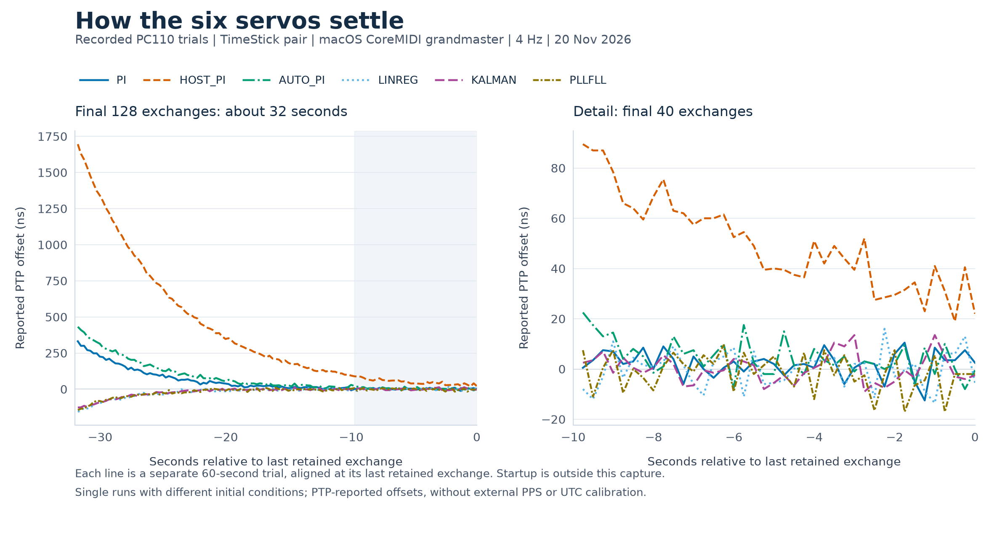
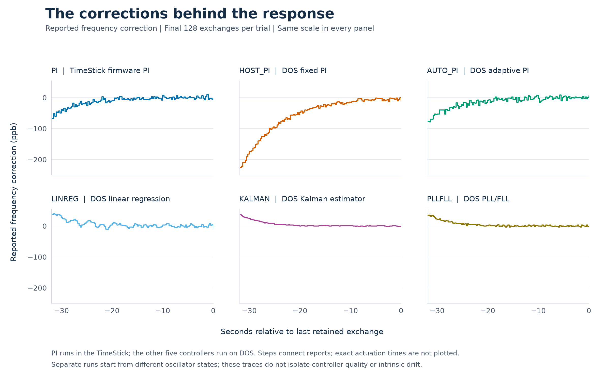
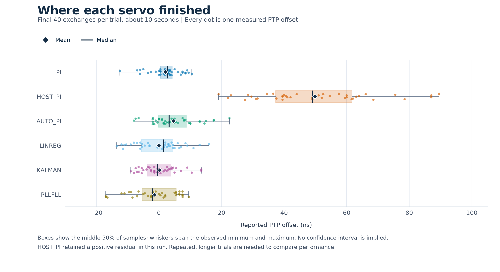

# PTP4D 0.5

PTP4D 0.5 adds five DOS-side servos, macOS CoreMIDI support, and a recorded
six-servo comparison on the IBM PC110. The default remains the TimeStick's
firmware PI follower, with no DOS clock writes.

## Downloads

- [PTP4D.EXE](https://github.com/ahmadexp/PTP4D/releases/download/v0.5/PTP4D.EXE): DOS executable, **77,784 bytes**.
- [SHA256SUMS](https://github.com/ahmadexp/PTP4D/releases/download/v0.5/SHA256SUMS): checksums for every attached executable, plot, and archive.
- [Servo graphs and data](https://github.com/ahmadexp/PTP4D/releases/download/v0.5/PTP4D-v0.5-servo-graphs.zip): PNG and SVG figures, all 768 retained samples in CSV, and the summary table.
- [Source and host tools](https://github.com/ahmadexp/PTP4D/archive/refs/tags/v0.5.zip): includes the standalone Linux/macOS grandmaster controller.

Executable SHA-256:

```text
5ef4fba69c2a3e682614f943fb988b84bb843b92ad41caf78d45248597c29634  PTP4D.EXE
```

## Runtime servos

Select a servo at startup with `/SERVO`. Stop and restart the foreground program
to change it. Ethernet timestamps and hardware actuation remain in the TimeStick.

| Selector | Controller location | Behavior |
| --- | --- | --- |
| `PI` | TimeStick | Existing firmware PI, unchanged default |
| `HOST_PI` | DOS | Fixed proportional/integral controller |
| `AUTO_PI` | DOS | PI with bounded gain scheduling and hysteresis |
| `LINREG` | DOS | Eight-point phase/frequency regression |
| `KALMAN` | DOS | Two-state phase/frequency estimator |
| `PLLFLL` | DOS | Phase correction with a smoothed frequency estimate |

Copy the new executable to the DOS machine. Start the compatible grandmaster,
then promptly start the follower:

```dos
PTP4D /PTP 60 /SERVO KALMAN /SYNC NONE
```

`PTP4D /PTP 0` retains the PI default and runs until Esc. Domain 42 and 4 Hz
remain fixed in this DOS build. Host servos require the firmware's negotiated
host-control extension. See the [servo guide](https://github.com/ahmadexp/PTP4D/blob/v0.5/docs/servo-inventory.md).

The release fixes a USB receive-loop delay that could invalidate a fresh
measurement token before a host correction was sent. Completed measurements
are now serviced before another blocking input read, including measurements
received during ACK handling. Generation, freshness, correction-bound, watchdog,
and STOP checks remain enforced. Regression cases cover all five host servos.

## macOS CoreMIDI

`tools/peer.py` now supports CoreMIDI and CoreFoundation through Python's
standard library, alongside the existing Linux ALSA transport. Keep
`tools/midi_transport.py` beside it. No additional MIDI package is required.

```sh
python3 tools/peer.py --list
python3 tools/peer.py --serial YOUR_TIMESTICK_SERIAL --mac YOUR_TIMESTICK_MAC --passive 3
python3 tools/peer.py --serial YOUR_TIMESTICK_SERIAL --mac YOUR_TIMESTICK_MAC --seconds 0
```

Enumeration requires an exact USB serial and one matching source/destination
pair. Offline or ambiguous endpoints are rejected. Passive mode sends no
commands. The controller checks identity, rate, leases, acknowledgments, queue
overflow, disconnection, and STOP restoration. It does not copy the laptop's
system time into the TimeStick. The optional SSH/COMrade pair controller still
requires a Linux/systemd grandmaster host; use the standalone peer on macOS.
See the [setup guide](https://github.com/ahmadexp/PTP4D/blob/v0.5/docs/setup.md).

## Hardware results and graphs

All six selections completed separate 60-second runs on an IBM PC110 with
MS-DOS 6.22, PicoPCMCIA 4.4, and compatible firmware advertising v0.22/protocol 2.
A second TimeStick was controlled by the Mac through CoreMIDI. Each run used
`/SYNC NONE`. Both ends acknowledged STOP/restoration and the PC110 returned
to its DOS prompt. All **768 retained exchanges** matched the grandmaster's
hardware timestamps and independent offset/delay calculations, with **zero
grandmaster timestamp errors**.



Only the final 128 exchanges, about 32 seconds, are retained from each run.
Time zero is each run's last retained exchange. Startup is outside this capture.
The right panel enlarges the final 40 exchanges, approximately 10 seconds:

| Servo | Mean offset (ns) | Maximum absolute offset (ns) | Offset standard deviation (ns) |
| --- | ---: | ---: | ---: |
| `PI` | 2.09 | 12.5 | 4.84 |
| `HOST_PI` | 49.85 | 89.5 | 18.18 |
| `AUTO_PI` | 4.62 | 22.5 | 6.96 |
| `LINREG` | -0.05 | 16.0 | 7.13 |
| `KALMAN` | 0.24 | 13.5 | 5.55 |
| `PLLFLL` | -1.44 | 17.0 | 7.13 |





HOST_PI retained a positive residual in this one-minute run. The separate runs
have different initial conditions; these results do not establish a controller
ranking. Offsets assume a symmetric path and have no independent PPS or UTC
calibration. Longer repeated trials are needed for stability comparisons.
[Raw evidence, graph interpretation, and reproduction](https://github.com/ahmadexp/PTP4D/tree/v0.5/docs/validation/servo-20261120).

## Build and validation

- Fresh Borland C++ 3.1 huge-model build, reproduced byte for byte.
- DOSBox-X 486 with FPU emulation disabled: help, refusal paths, and all four DOS test suites passed.
- C89 tests passed with warnings as errors, AddressSanitizer, and UndefinedBehaviorSanitizer, including 37 simulated sessions.
- All 33 Python tests passed, including native virtual CoreMIDI input/output and hardware-evidence checks. CI covers Linux and macOS.

The physical trials used the 0.5 development executable. The release changes
only its displayed version string in the DOS source, then rebuilds and retests
it. The release binary has a distinct checksum and has not been rerun on the
PC110. [Build provenance](https://github.com/ahmadexp/PTP4D/blob/v0.5/docs/validation/v0.5-release.md).

## Clock modes and compatibility

Version 0.5 includes explicit follower/GM roles and guarded `PHC2DOS` date/time
copying. PHC2DOS requires a separately verified epoch, timescale, UTC/local
mapping, and bounded validity period; DOS setters can also update the RTC.
PHC2DOS and DOS-controlled GM operation have software tests but remain unverified
on the physical PC110. The supplied free-running peer is not a verified UTC source.
DOS-derived grandmaster time (`DOS2PHC`) is unsupported by the current firmware
and is rejected before hardware access. See the
[clock-mode guide](https://github.com/ahmadexp/PTP4D/blob/v0.5/docs/clock-modes.md).

The tested setup still requires the matching PICOCARD driver, a readable microSD,
direct USB connection, and compatible TimeStick MIDI timing firmware. Stop shared
storage transfers before taking PicoPCMCIA ownership. Firmware, DOS, and the
compiler are supplied separately. The [0.4 release](https://github.com/ahmadexp/PTP4D/releases/tag/v0.4)
remains available.

Released under the MIT license.
