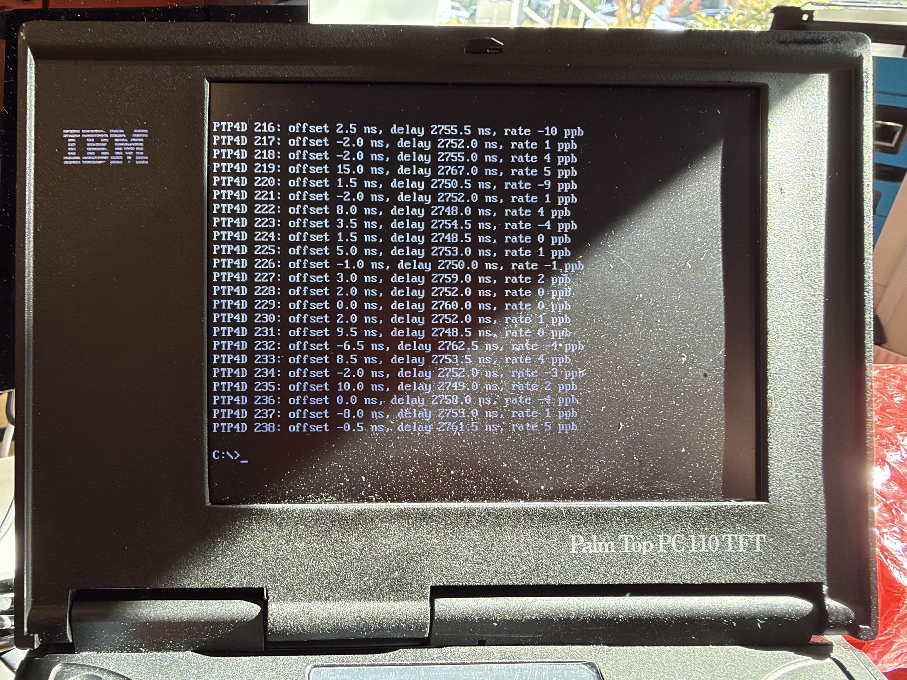

# PC110 servo hardware trials, 2026-11-20

All six follower selections completed separate 60-second runs against a
TimeStick grandmaster controlled by macOS CoreMIDI. Each run used domain 42,
4 Hz, and `/SYNC NONE`. Both endpoints acknowledged STOP and restoration, and
the PC110 returned to its DOS prompt after every accepted run.

## Results

Statistics below use the final 40 retained exchanges, approximately 10 seconds.
The final 128 exchanges from each run are preserved. All **768 retained exchanges**
matched the grandmaster's t1 and t4 records, and independent recomputation
reproduced every reported offset and path delay. There were **zero grandmaster
timestamp errors**, no console overflow in the accepted captures, and 14 follower
lease renewals per run.

| Servo | Exchanges | Host corrections acknowledged | Mean offset (ns) | Max absolute offset (ns) | Offset standard deviation (ns) |
| --- | ---: | ---: | ---: | ---: | ---: |
| `PI` | 238 | 0 | 2.09 | 12.5 | 4.84 |
| `HOST_PI` | 237 | 236 | 49.85 | 89.5 | 18.18 |
| `AUTO_PI` | 238 | 237 | 4.62 | 22.5 | 6.96 |
| `LINREG` | 238 | 237 | -0.05 | 16.0 | 7.13 |
| `KALMAN` | 238 | 237 | 0.24 | 13.5 | 5.55 |
| `PLLFLL` | 238 | 237 | -1.44 | 17.0 | 7.13 |

These are single-run PTP-reported offsets under the symmetric-path assumption.
They are not an independent PPS calibration or proof of absolute UTC accuracy.
They do not establish a definitive ranking of the controllers. HOST_PI retained
more residual offset within this one-minute window; longer settling and repeated
runs would be needed for a performance comparison. No DOS date/time or RTC
setters were called, and no laptop clock was copied into either TimeStick.

## Setup and executable

- IBM PC110, 486SX, MS-DOS 6.22; PicoPCMCIA hardware 4.4 advertising firmware
  0.22 and mailbox protocol 2. Numeric version words do not identify a patch suffix.
- One TimeStick connected directly to PicoPCMCIA, a second connected to the Mac,
  and Ethernet between them. The laptop ran `tools/peer.py` through CoreMIDI.
- The corrected development executable was installed separately as `C:\PTP5.EXE`.
  The existing `C:\PTP4D.EXE` and published version 0.4 binary were preserved.
- Tested executable: 77784 bytes, CRC-32 `8156834a`, SHA-256
  `d5fd81d048b9e248d63a251bdc32b6e8b626a1a326223ab69336823d9865ebd4`. Its transfer and final readback checks matched.

The SD transfer batch was complete and readback-verified before testing, with
no active copy process and no Pico SD export on the serial host. A saved SWD
file was backed up; the resident driver's `/RESTORE` command identified it as
stale from a prior boot and removed it without restoring old mappings. No
firmware, SD export, USB ownership setting, or game catalog was changed.

## Failure found and corrected

The initial HOST_PI attempts stopped after one acknowledged correction. A
correlated op 7 response returned result 4, with the device still armed and no
hardware error. STOP and restoration succeeded. A
[representative failure report](pre-fix-host-pi.txt) is preserved.

The DOS receiver could finish a measurement, then issue another blocking USB IN
read before acting on it. The next exchange invalidated the pending correction's
measurement token. The corrected loop returns after processing the current USB
packet when a host correction is pending, and services telemetry received during
ACK handling before making another input request. No freshness check, generation
binding, correction limit, or watchdog was weakened; rejections still stop the run.

New simulated cases reproduce blocking IN reads and telemetry arriving while an
ACK is pending, for all five host servos. The pre-fix code fails the stale-token
assertion. The corrected code passes all 37 simulated sessions, the C sanitizer
suites, 33 Python tests, and the Borland DOS tests with FPU emulation disabled.

One early PI capture overflowed the serial console buffer. Subsequent runs saved
reports directly to DOS files and read them after the prompt returned. A separate
serial directory-query timeout occurred before the first KALMAN attempt could
start; a fresh query succeeded, and its recorded trial completed normally.
These incomplete attempts are excluded from the comparison table.

## Evidence and final state

[Summary JSON](summary.json) and [summary CSV](summary.csv) include counts and
statistics. Each servo directory contains the DOS report, grandmaster JSON log,
and recomputed timestamp analysis. USB serials, MAC addresses and host/account
paths are omitted. Grandmaster log times are elapsed seconds from opening its
controller; the PHC timestamps are preserved unchanged.

Recompute any run, for example:

```sh
python3 tools/analyze.py docs/validation/servo-20261120/kalman/dos.json \
  docs/validation/servo-20261120/kalman/grandmaster.jsonl
```

The final PC110 check confirmed its DOS prompt, active resident/card handshake,
readable SD `P:` root, and matching test-executable checksum. The laptop's final
receive-only check reported phase 9, restored 1, armed 0, and sent no commands.
Both timing sessions were stopped. The test executable and DOS report files were
left available for further experiments.



The supplied photograph matches the final AUTO_PI display values in this run.
It was converted from HEIC to JPEG and resized for the README, with metadata
removed; the display content and framing were preserved.

PHC2DOS date/time writes, DOS-controlled GM operation, long-duration stability,
and independent accuracy measurements remain outside this test.
