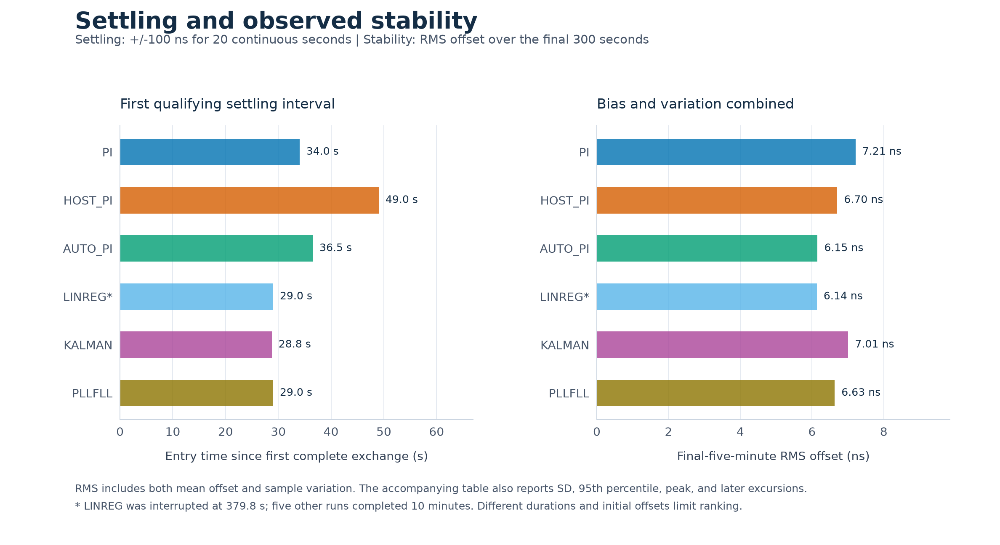
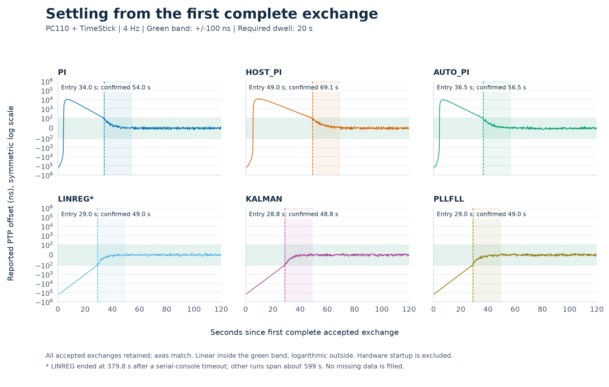
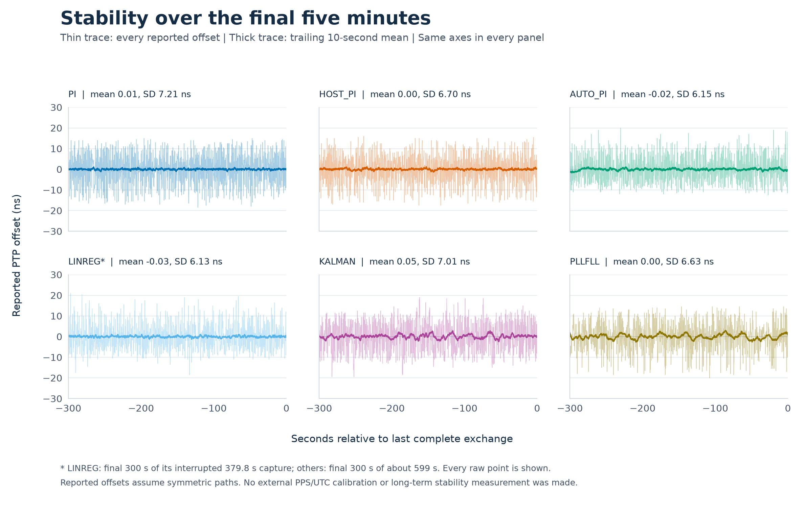
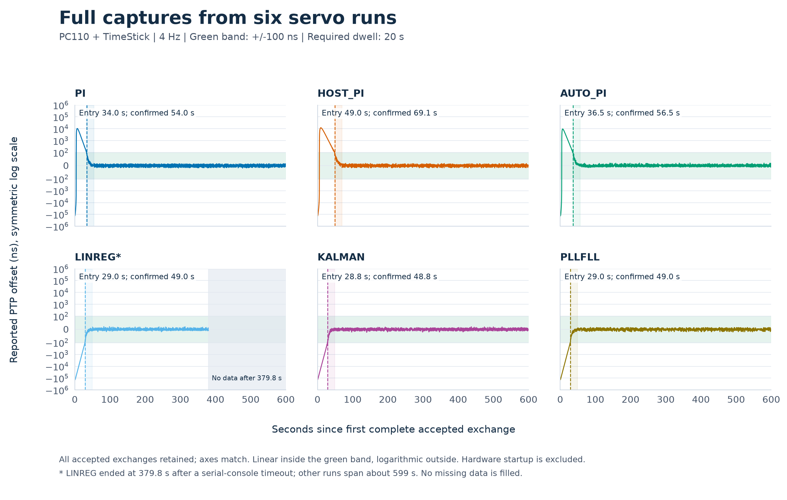
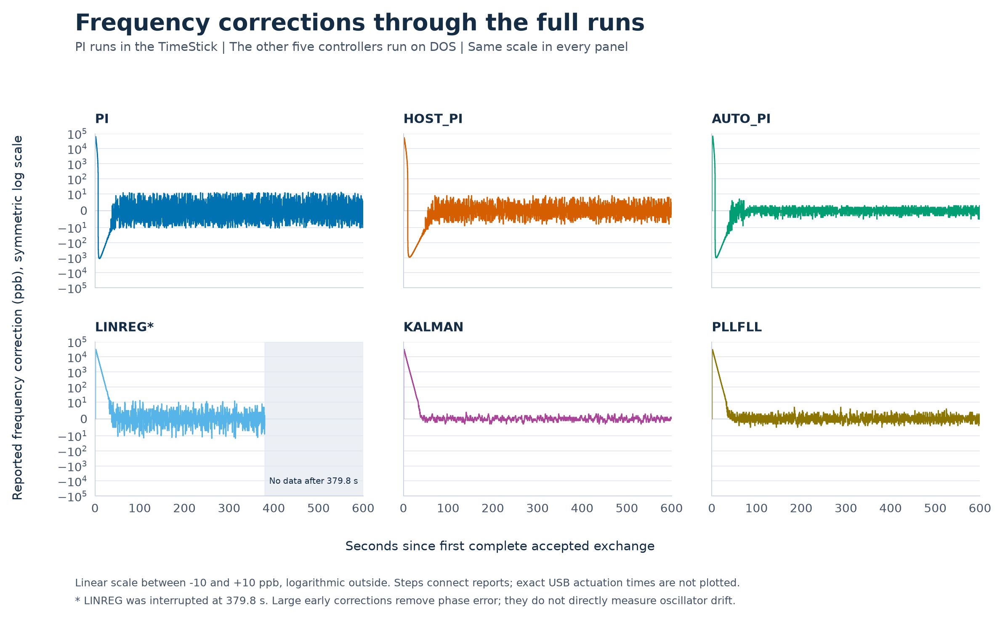

# Long servo trials with full capture, 2026-11-20

Five servos completed separate 600-second runs on the IBM PC110 and PicoPCMCIA,
against a laptop-controlled TimeStick grandmaster using CoreMIDI. LINREG was
interrupted by a serial-console read timeout after a **379.8-second capture**;
the harness sent Esc and both devices verified STOP/restoration. Its shorter
capture is preserved and marked in every graph. It did not complete the
planned ten-minute trial.

The full **13,495 accepted exchanges** are preserved, including startup
settling from the first complete measurement. Every t1 and t4 matched the active
grandmaster session, every offset and path delay recomputed correctly, and there
were zero timestamp errors or missing sequence numbers. Both endpoints verified
STOP and restoration after every run.



The settling criterion is an inclusive **+/-100 ns band for 20 continuous
seconds**. The bar shows entry into the first qualifying interval; confirmation
comes at least 20 seconds later. Stability uses the **final 300 seconds** of
each capture, including the shorter LINREG capture. RMS includes mean bias and
sample variation. The [recorded protocol](protocol.md) and [plan](plan.json)
define these choices.

## Settling from the first complete exchange



| Servo | Initial offset (ns) | Entry (s) | Confirmed (s) | Last-exit settling (s) | Later out-of-band samples |
| --- | ---: | ---: | ---: | ---: | ---: |
| `PI` | -138426.5 | 34.03 | 54.04 | 34.03 | 0 |
| `HOST_PI` | -138473.0 | 49.04 | 69.06 | 49.04 | 0 |
| `AUTO_PI` | -138456.5 | 36.53 | 56.54 | 36.53 | 0 |
| `LINREG` | -138502.0 | 29.02 | 49.04 | 29.02 | 0 |
| `KALMAN` | -138351.5 | 28.77 | 48.79 | 28.77 | 0 |
| `PLLFLL` | -138389.0 | 29.02 | 49.04 | 29.02 | 0 |

Last-exit settling requires remaining inside the band through the end, with at
least 20 seconds observed after entry. Later out-of-band counts are individual
samples after the first confirmation, not independent disturbance events.
The first measurement is time zero. Configuration, link startup, and the
firmware's initial epoch acquisition occur before it and are excluded.
LINREG's last-exit result is established only through its earlier stop at 379.8 s.

PI, HOST_PI, and AUTO_PI showed positive overshoots of approximately 10.4, 12.1,
and 9.6 microseconds after their initial negative offsets. LINREG, KALMAN, and
PLLFLL approached zero from the negative side. All six established the required
dwell, with no later out-of-band samples in their respective observation spans.
HOST_PI took the longest to enter the band in these runs, but its earlier
one-minute residual was absent from the longer final stability window.

## Stability over the final five minutes



| Servo | Samples | Mean (ns) | SD (ns) | RMS (ns) | 95th percentile absolute (ns) | Peak absolute (ns) |
| --- | ---: | ---: | ---: | ---: | ---: | ---: |
| `PI` | 1200 | 0.008 | 7.21 | 7.21 | 14.00 | 18.5 |
| `HOST_PI` | 1200 | 0.000 | 6.70 | 6.70 | 13.50 | 17.5 |
| `AUTO_PI` | 1200 | -0.016 | 6.15 | 6.15 | 11.00 | 20.0 |
| `LINREG` | 1200 | -0.026 | 6.13 | 6.14 | 12.00 | 21.0 |
| `KALMAN` | 1200 | 0.048 | 7.01 | 7.01 | 12.00 | 20.5 |
| `PLLFLL` | 1200 | 0.001 | 6.63 | 6.63 | 13.50 | 20.0 |

Every raw point is plotted. The thicker trace is a trailing ten-second mean.
SD is the population standard deviation of the captured offsets. The percentile
uses linear interpolation between sorted absolute offsets. The tables are
descriptive statistics of sequential samples; they are not confidence intervals.
[Detailed metrics](comparison.json) also include offset trend, in-band fraction,
sample spacing, and correction mean and standard deviation.
LINREG's window runs from 79.8 to 379.8 seconds after its first exchange; the
other windows run from approximately 299 to 599 seconds. All six windows contain
1200 samples. Unequal run durations limit direct comparisons of later stability.

## Complete runs and frequency corrections



The offset panels have common symmetric-log axes, with a linear region inside
the green +/-100 ns band. The startup figure shows the first 120 seconds using
the same scale. No startup samples are discarded or inferred.



PI runs in the TimeStick firmware; the five other controllers run on DOS.
Corrections are reported actuation values, not an independent estimate of
intrinsic oscillator drift. Steps connect reports and do not locate the exact
USB actuation time. The frequency plots use a common symmetric-log scale with
a linear region from -10 to +10 ppb.

## Capture completeness

| Servo | Complete exchanges | Timestamp span (s) | Host commands acknowledged | DOS lease renewals |
| --- | ---: | ---: | ---: | ---: |
| `PI` | 2395 | 598.969 | 0 | 147 |
| `HOST_PI` | 2395 | 598.972 | 2394 | 147 |
| `AUTO_PI` | 2396 | 599.207 | 2395 | 147 |
| `LINREG` | 1519 | 379.798 | 1518 | 93 |
| `KALMAN` | 2395 | 598.969 | 2394 | 147 |
| `PLLFLL` | 2395 | 598.965 | 2394 | 147 |

Each run was requested for 600 seconds. The five completed runs have a slightly
shorter first-to-last complete-exchange span because of initial acquisition and
the sampling interval. LINREG's span is 379.8 seconds because of the interruption.
Every accepted exchange is retained, with consecutive Sync and Delay sequences.
All hardware timestamp matches were checked again using only the active
grandmaster generation, excluding any stale telemetry seen before START.
The five completed runs had no forced Esc exits. LINREG's serial-console read
timed out after eight seconds without a reply; the harness then sent Esc and
verified recovery. This was a capture-control interruption, with no recorded
PTP timestamp error, timing-command failure, capture overflow, or missing
sequence number. All DOS report transfers passed checksum verification.
The [LINREG interruption record](linreg/interruption.json) preserves the failure
message and recovery status. Its peer exit code was not persisted by the aborted
harness and is recorded as null; the actual STOP acknowledgement and restoration
confirmation remain in the grandmaster log.

The recorded randomized order was AUTO_PI, PI, HOST_PI, PLLFLL, KALMAN, LINREG.
A separate 30-second KALMAN capture check is excluded from the comparison.
An existing filename from that preliminary check was detected before the long
KALMAN session began; the long run used a fresh filename and preserved that
earlier report. No failed timing session resulted from the filename check.

## Reproduce the analysis and graphs

- [All exchanges, CSV](exchanges.csv), including four integer hardware timestamps
  per sample, elapsed time, offset, path delay, and reported correction.
- [Comparison CSV](comparison.csv), [comparison JSON](comparison.json), and
  [capture summary](summary.json).
- SVG figures: [comparison](long-servo-comparison.svg),
  [settling](long-servo-settling.svg), [stability](long-servo-stability.svg),
  [full offsets](long-servo-offsets.svg), [corrections](long-servo-corrections.svg).
- Full DOS reports, grandmaster logs, and timestamp analyses:
  [PI](pi/), [HOST_PI](host_pi/), [AUTO_PI](auto_pi/), [LINREG](linreg/),
  [KALMAN](kalman/), [PLLFLL](pllfll/).

From the repository root, in a Python environment with Matplotlib 3.11.2:

```sh
python3 -m pip install matplotlib==3.11.2
python3 tools/plot_long_servos.py
python3 tools/analyze.py docs/validation/servo-long-20261120/kalman/dos.json \
  docs/validation/servo-long-20261120/kalman/grandmaster.jsonl
```

The plotting script reads only recorded data and regenerates all PNG/SVG figures
and CSV/JSON metrics. `tools/test.py` independently checks all six timestamp
correlations, uninterrupted sequences, metric calculations, and the combined CSV.
USB serials, MAC addresses, and private host/account paths are omitted from the
public evidence. Grandmaster log times are elapsed seconds from opening its
controller; original hardware timestamps are unchanged.

## Diagnostic build and setup

The published v0.5 executable keeps only its final 128 exchanges. These trials
used a separate full-capture diagnostic, installed as `C:\PTPLONG.EXE`. It
reserves five RAM banks before taking card ownership, holds 2560 records, and
stops explicitly if full. No DOS file I/O is added during the control loop;
reports are written after STOP and card restoration.

- Capture source: [`7a37484`](https://github.com/ahmadexp/PTP4D/commit/7a374840734189455135e8041bffa42000e040e1).
- [Build provenance and source hashes](build-provenance.json). Source hashes use
  the CRLF working-tree files selected by `.gitattributes` for the DOS build.
- Compiler: Borland C++ 3.1, huge memory model; DOSBox-X with FPU emulation disabled.
- Build: `python3 build-dos.py --bcc-dir /path/to/BORLAND --dosbox /path/to/dosbox-x --full-capture`.
- Executable: **66248 bytes**, SHA-256
  `f79a23670d0d21367bc23121115d8ae99283c347157d087776fbbd53733b2c8f`.
- IBM PC110, 486SX, MS-DOS 6.22; PicoPCMCIA hardware 4.4 advertising firmware
  0.22 and mailbox protocol 2. Numeric version words do not identify a patch suffix.
- Two TimeSticks linked by Ethernet; follower directly on PicoPCMCIA, grandmaster
  on Apple Silicon macOS through CoreMIDI. Domain 42, 4 Hz, `/SYNC NONE`.

See the [full-capture procedure](../../setup.md#retaining-a-complete-ten-minute-run).
Storage transfers were complete before testing. No DOS/RTC time setters,
firmware programming, SD export, or USB ownership setting changes were used.
The original release and earlier test executables remain separate.

The [final hardware check](final-state.json) confirmed the DOS prompt, active
resident/card handshake, readable SD root, and matching diagnostic executable
checksum. The laptop's receive-only check reported phase 9, restored 1, armed 0,
and sent no commands. Both timing sessions were stopped after the final capture.

## Interpretation and limits

These are one run per servo, with unequal durations, different initial offsets,
and no common injected phase step or temperature control. They support comparison of the
observed settling and short-term behavior, not a definitive controller ranking.
The full runs provide the startup data absent from the earlier
[one-minute trials](../servo-20261120/); those original results remain available.

Offsets are reported by PTP under the symmetric-path assumption. There was no
independent PPS measurement or UTC calibration. Ten minutes does not establish
hours-long temperature stability, holdover, or behavior under packet loss or
link disturbance. PHC2DOS writes and DOS-controlled GM operation remain outside
this hardware test.
